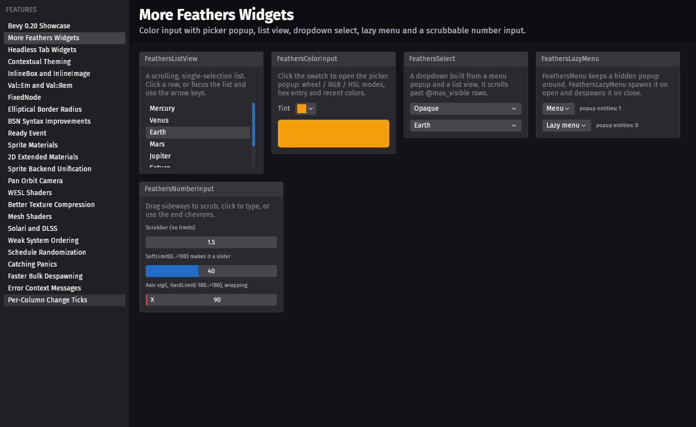
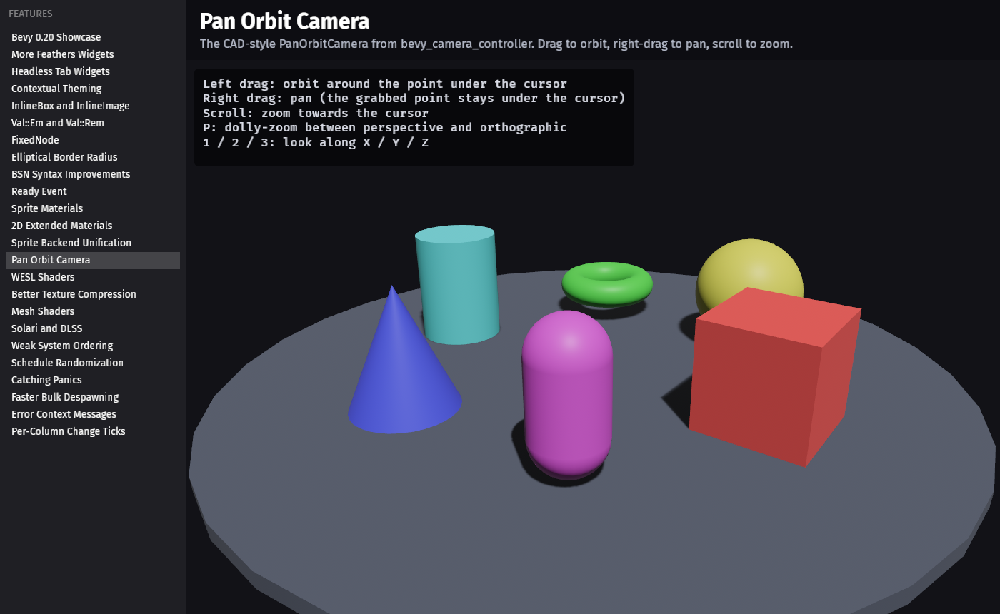
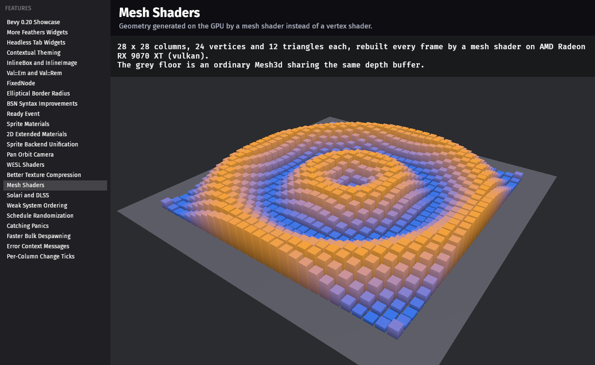
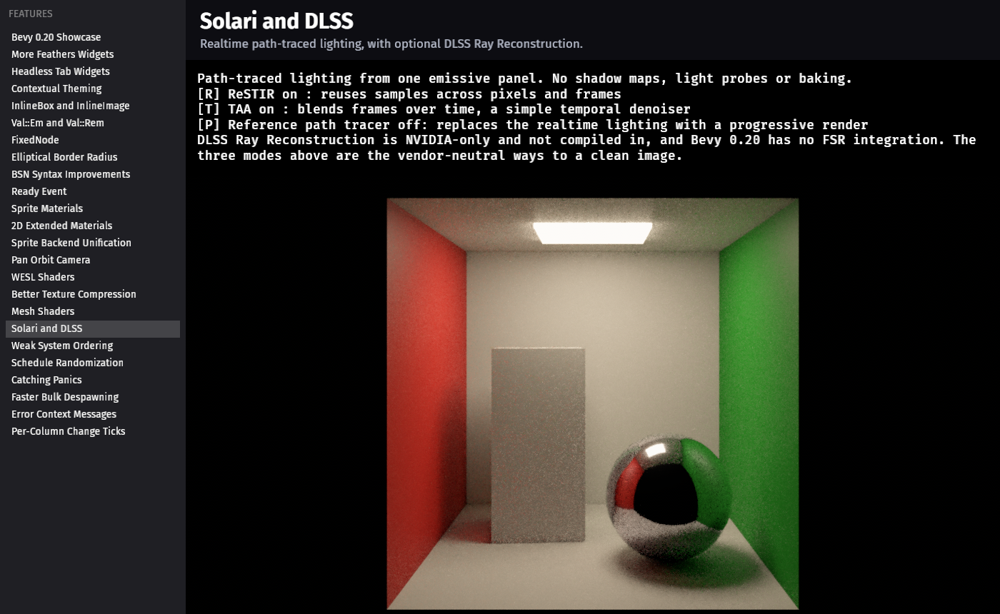
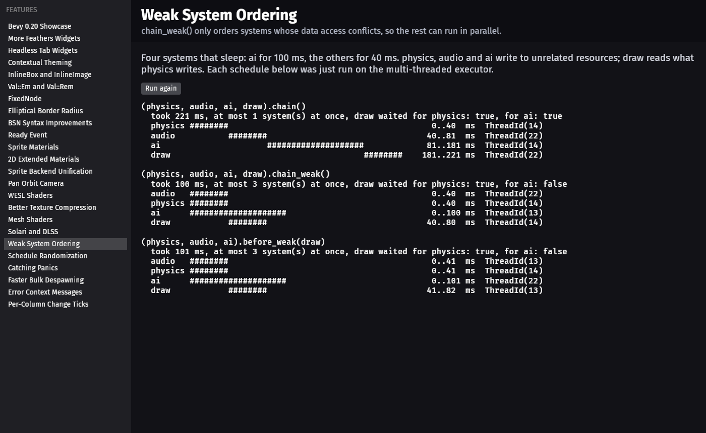

# Bevy 0.20 Showcase

A runnable tour of the features introduced in [Bevy 0.20](https://bevy.org/news/bevy-0-20/).
One app, one scene per feature, picked from the sidebar.



| | |
|---|---|
|  |  |
|  |  |

Requires a recent stable Rust toolchain (built with 1.97) and a GPU with Vulkan, DirectX 12 or
Metal support.

```sh
cargo run
```

The first build compiles Bevy with optimizations and takes a while. On first launch the asset
processor compresses `assets/render/tiles.png` into `imported_assets/`.

## Scenes

| Group | Scenes |
|---|---|
| UI | More Feathers Widgets, Headless Tab Widgets, Contextual Theming, InlineBox and InlineImage, Val::Em and Val::Rem, FixedNode, Elliptical Border Radius |
| Scenes | BSN Syntax Improvements, Ready Event |
| 2D | Sprite Materials, 2D Extended Materials, Sprite Backend Unification |
| 3D | Pan Orbit Camera, WESL Shaders, Better Texture Compression, Mesh Shaders, Solari and DLSS |
| ECS | Weak System Ordering, Schedule Randomization, Catching Panics, Faster Bulk Despawning, Error Context Messages, Per-Column Change Ticks |

Mesh Shaders shows an "unsupported" message on GPUs or backends without mesh shader support.

Solari is opt-in because it needs hardware ray tracing:

```sh
cargo run --features demo_solari
```

Solari's raw output is noisy and is designed to be cleaned up by DLSS Ray Reconstruction, which
is NVIDIA-only and needs the DLSS SDK at build time, so it is not enabled here (see the comment
at the top of `src/demos/solari/mod.rs`). Bevy 0.20 has no FSR integration. The scene offers
three vendor-neutral modes instead:

| Key | Mode |
|---|---|
| `T` | TAA as a temporal denoiser (on by default) |
| `R` | ReSTIR sample reuse |
| `P` | Reference path tracer, which converges to a noise-free image |

## Layout

- `src/shell.rs`: the launcher (sidebar, header, log panel, UI cameras).
- `src/demo.rs`: the list of scenes.
- `src/demos/<group>/`: one file per scene, each group behind a `demo_*` cargo feature.
- `assets/`: WESL shaders and the texture used by the compression scene.

## Environment variables

| Variable | Effect |
|---|---|
| `SHOWCASE_DEMO=<Variant>` | Start on a scene, e.g. `SpriteMaterial` (names from `src/demo.rs`). |
| `SHOWCASE_TOUR=<seconds>` | Step through every scene, then exit. |
| `SHOWCASE_SCREENSHOT=<path>` | Save a screenshot after `SHOWCASE_SHOT_AT` seconds (default 4), then exit. |

`tools/run_demo.ps1 -AllFeatures -Demo <Variant>` builds, runs one scene and saves a screenshot
to `target/run/`.

## Tested on

Windows 11, AMD Radeon RX 9070 XT, Vulkan. Other platforms and GPUs are untested.

## License

Licensed under either of [Apache License, Version 2.0](LICENSE-APACHE) or
[MIT license](LICENSE-MIT) at your option.
